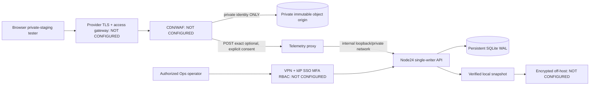

# VELANCE P6 — Private staging và trust boundaries

**Trạng thái:** đang chuẩn bị pre-production, **không được phép Internet/public deploy**. Contract máy đọc được: [`config/p6/private-staging.json`](../config/p6/private-staging.json); local validation: [`tools/p6/check.mjs`](../tools/p6/check.mjs). Đây là đặc tả provider-neutral, **không phải** Terraform/IAM/WAF/CDN được triển khai. Thực hiện theo kiến trúc [`p5-system-design.md`](p5-system-design.md) và checklist [`p5-public-launch-checklist.md`](p5-public-launch-checklist.md).

## 1. Đường đi request và phân quyền

### Public vs private URL

| URL/method | Public staging edge | Hành vi |
| --- | --- | --- |
| `GET/HEAD /`, `/index.html` | chỉ sau staging auth | Trả 307 tới release SHA, `no-store`, không có state theo user |
| `GET/HEAD /r/<64hex>/<allowlisted-file>` | chỉ sau staging auth | Immutable byte snapshot, ETag representation-aware, 304; không phục vụ master source/backup/Ops |
| `POST /api/telemetry` | **TẮT mặc định** | Chỉ bật khi đã phê duyệt privacy/consent, upstream private được cấu hình, JSON ≤256 KiB; không cache |
| `GET/HEAD /api/telemetry`, alias, query, encoded route | denied | Không rewrite thành đường dẫn hợp lệ |
| `/ops`, `/metrics`, `/health/*`, `/api/summary`, `/api/sessions*` | denied | Chỉ nội bộ sau VPN/IdP RBAC; không dùng static edge để serve |
| `/.git`, `/.env`, `/tools`, DB/WAL/SHM/backup, masters | denied | Allowlist nguồn public và immutable snapshot; không directory listing |

`tools/delivery/server.mjs` là **local loopback preview**, chỉ chấp nhận upstream HTTP loopback và không chấp nhận Host/Origin khác. Không đưa trực tiếp preview Node ra Internet; không tin `Host`, `X-Forwarded-*`, hay header tự xưng là authenticated nếu provider gateway chưa verify và strip/replace. `tools/ops/server.mjs` phục vụ cả private Ops và read API trên loopback: phải có network ACL **và** IdP phía trước mới đủ. Không dùng localhost check thay thế SSO/MFA.

## 2. Contract triển khai và cấu hình provider cần đưa bằng chứng

1. Tách ba môi trường dev/private-staging/public-prod; account/project, IAM, buckets, keys, database, logs, DNS và quota độc lập. Staging nhận **synthetic/user-owned licensed fixture**; không upload 96 asset đang `UNVERIFIED`.
2. Static object storage **private read/list**, block-all-public-access; CDN truy cập bằng identity/OAC/mTLS có chính sách chặt theo bucket và prefix release. Chứng minh trực tiếp origin URL/list bị `403`, CDN hợp lệ đọc được và không chấp nhận origin bypass. Release SHA và manifest có checksum từng file; phát hành staging only sau verify. Origin không có Ops/DB/backup.
3. Edge kiểm soát HTTPS TLS 1.2+ và cert renewal, redirect HTTP→HTTPS, canonical route, `Content-Encoding` trong cache key hoặc response variation, `Vary: Accept-Encoding`, ETag và 304 theo representation; `/` không cache, `/r/<sha>/` cache immutable. WAF bot/rate guard chống lạm dụng telemetry; query normalization không bypass allowlist. Thêm HSTS sau kiểm định.
4. Telemetry chỉ là exact POST khi opt-in thực và privacy notice duyệt; đường API khác denied. Do not cache 4xx/5xx telemetry, không log body/cookie/token/UA/IP ở ingress theo mặc định. Route chỉ đến private API, không có GET proxy.
5. Ops/read/health/metrics chỉ qua internal/VPN + IdP SSO/MFA/RBAC; enforce role ở reverse proxy và internal network. Test unauthenticated, viewer role, operator role, admin role và break-glass. Thiếu IdP hoặc gateway ⇒ **no-go**.
6. Node24 unprivileged, process runtime chỉ đọc static assets và ghi DB volume riêng (`0700` dirs, `0600` DB/backup). `--host 127.0.0.1` và firewall trên interface; supervisor restart/health; không expose container 8090/8081 trên public interface. Volume DB persistent; snapshots local riêng; encrypted off-host replication cần key/IAM riêng không cấp delete cho runtime. Secrets chỉ từ provider secret manager, không commit env thực.
7. Staging secrets, quotas và billing được owner phê duyệt trước provisioning. Bản config trong repo có `deployEnabled=false` và `publicLaunchAuthorized=false`; sửa thành `true` khiến local gate fail. Đây là **safety contract**, không phải một công cụ thực thi deployment.

## 3. Nghiệm thu provider bắt buộc

| Gate | Bằng chứng tối thiểu | Trạng thái |
| --- | --- | --- |
| G0 asset licensing/lineage | 16 GLB +80 WebP, môi trường/brand, independent reviewer | `BLOCKED` (0/96) |
| G1 TLS private origin, WAF, Ops SSO/MFA, privacy | cấu hình export + external negative scans, consent notice | `NEEDS_PROVIDER_TEST` / privacy `BLOCKED` |
| G2 staging / WAN | real CDN PoP MISS/HIT, bandwidth, 24–72h soak, thiết bị thật | `NEEDS_PROVIDER_TEST` |
| G3 clean CI + canary/rollback, off-host restore và paging | CI run/immutable artifact, traced origin/edge rollback, restore duration và alert delivery | `NEEDS_PROVIDER_TEST` |
| G4 legal/security/privacy/SRE/owner signoff | biên bản, timestamp, release SHA và domain | `NO-GO` |

**Quy mô:** mục tiêu 1.000 visits/ngày / burst 100 cold users không đòi Kubernetes ngay. Không được đồng nhất P4 virtual 100 HTTP clients (chỉ max16 downloads) với 100 browser độc lập. P4 44,15 MB cold và 3,53 Gbps edge→browser theoretical burst vẫn là rủi ro; ưu tiên lazy-load GLB theo xe đang xem. Xem [`p5-capacity-cost.md`](p5-capacity-cost.md).
